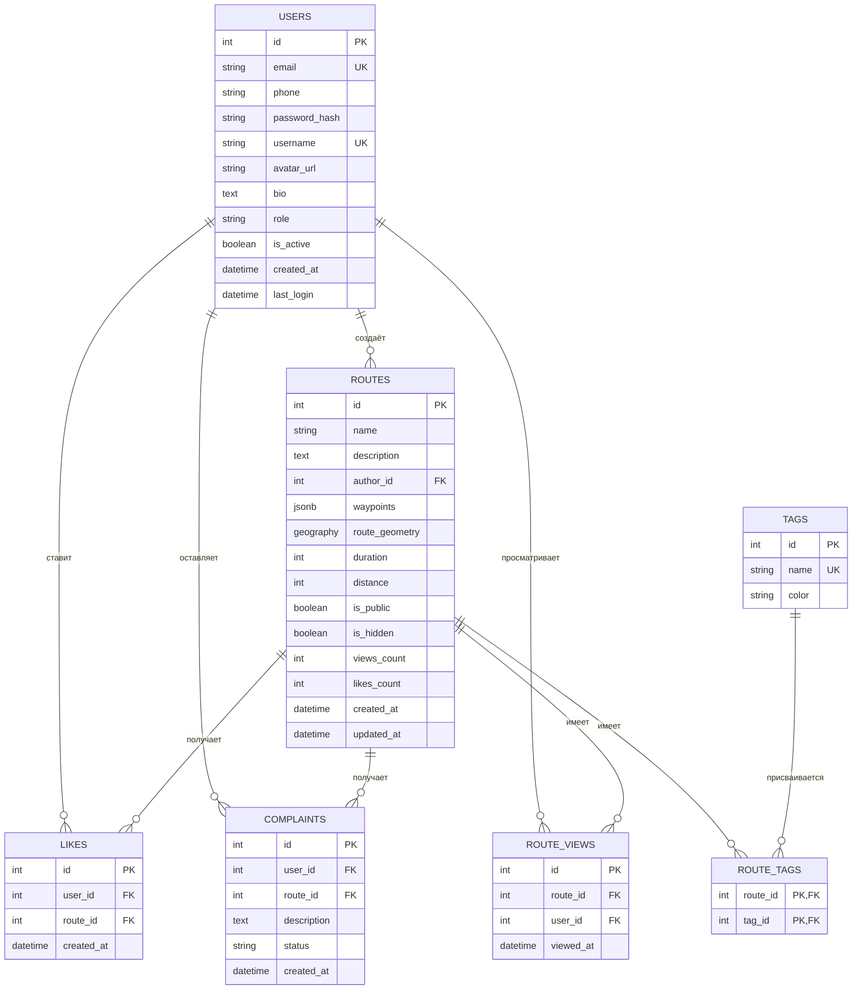

# Техническое задание: сервис пеших маршрутов

## 1. Общее описание

Сервис для создания, публикации и поиска пеших маршрутов. Пользователи строят маршруты по точкам на карте, делятся ими, ищут маршруты рядом с собой по фильтрам. Присутствует модерация контента и ролевая модель доступа.

Платформы:
- Веб-приложение — единая точка входа для пользователей, менеджеров и администраторов.
- Мобильное приложение — для пользователей (iOS, Android).

Архитектура: API-first. Один бэкенд обслуживает веб-приложение и мобильное приложение. Клиенты взаимодействуют через REST API.

Проект выполняется командой из 5 человек, состав и распределение ролей указаны в разделе 2.1.

## 2. Роли пользователей

- Пользователь: работа с картой, создание маршрутов, личный кабинет, лайки, жалобы.
- Менеджер / техподдержка: обработка жалоб, просмотр статистики.
- Администратор: управление пользователями, полный доступ к статистике и модерации.

### 2.1. Состав команды разработки

| Роль | ФИО | Зона ответственности |
|------|-----|----------------------|
| Тимлид | Василевская В.В. | Координация, приоритизация, ревью, коммуникация с заказчиком |
| Архитектор | Дадаев А.Х. | Проектирование системы, схема БД, контракты API, инфраструктура, безопасность |
| Бэкенд-разработчик | Сергеев А.С. | Серверная логика, REST API, интеграция с OSRM, работа с БД |
| Фронтенд-разработчик | Со А.А. | Веб-приложение, карта, интерфейсы, мобильное приложение |
| Тестировщик | Лебедева А.А. | Тест-планы, автоматизация тестирования, баг-репорты, регресс |

## 3. Функциональные требования

### 3.1. Веб-приложение

Доступно всем ролям. Интерфейс меняется в зависимости от роли.

Пользователь:

- Карта:
  - Отображение текущей геолокации.
  - Отображение области вокруг пользователя.
- Личный кабинет:
  - Фото профиля, био, телефон, почта.
- Маршруты:
  - Фильтр маршрутов:
    - Радиус поиска (время до маршрута).
    - Время прохождения маршрута.
    - Теги: еда, развлечения, прогулка, исторический.
  - Пул маршрутов в области по геолокации:
    - Карточки самых просматриваемых и лайкнутых маршрутов, полностью или частично находящихся в зоне пользователя и соответствующих фильтрам.
    - Карточка содержит: название, описание, отображение на карте, количество лайков, кнопку жалобы.
  - Создание маршрута:
    - Точки маршрута по координатам.
    - Название, описание, теги.
  - Жалобы:
    - Идентификатор, описание.

Менеджер / техподдержка:

- Статистика: новые пользователи, просмотры маршрутов за период.
- Обработка жалоб: идентификатор жалобы, идентификатор маршрута, описание, смена статуса.

Администратор:

- Просмотр списка пользователей.
- Экран статистики.
- Управление ролями и блокировками.

### 3.2. Мобильное приложение

Доступно роли «Пользователь». Функционал совпадает с пользовательской частью веб-приложения.

### 3.3. Серверная часть

- Аутентификация и авторизация (JWT: access + refresh).
- CRUD пользователей, маршрутов, тегов, жалоб.
- Построение маршрутов через OSRM с расчётом времени и дистанции.
- Поиск маршрутов по радиусу, времени прохождения, тегам.
- Лайки, счётчики просмотров.
- Модерация: жалобы, скрытие маршрутов.
- Статистика для администратора и менеджера.
- Загрузка и хранение аватарок.
- Rate limiting и защита API.

## 4. Технологический стек

### 4.1. Клиенты

Веб-приложение:
- React — библиотека для создания интерфейсов.
- Vite — сборщик проекта.
- Leaflet — библиотека для отображения карт.

Мобильное приложение:
- React Native — фреймворк для создания мобильных приложений на JavaScript (iOS и Android из одного кода).

### 4.2. Бэкенд

- FastAPI — фреймворк на Python для создания REST API.
- SQLAlchemy — библиотека для работы с базой данных из Python.
- GeoAlchemy2 — расширение SQLAlchemy для работы с геоданными.
- Pydantic — валидация входящих данных (идёт в комплекте с FastAPI).
- Аутентификация: JWT (access + refresh).
- Асинхронные задачи: BackgroundTasks (встроено в FastAPI).

### 4.3. Данные и инфраструктура

- БД: PostgreSQL + PostGIS.
- Кеш: Redis.
- Файловое хранилище: локальная папка на сервере (volume в Docker).
- Маршрутизация: OSRM.
- Веб-сервер: Nginx (SSL, reverse proxy, раздача статики, rate limiting).
- Контейнеризация: Docker + Docker Compose.
- CI/CD: GitLab CI.
- VCS: Git (GitLab).

### 4.4. Обоснование выбора бэкенда

Выбран FastAPI по следующим причинам:
- Скорость разработки выше, чем у Java Spring Boot.
- Асинхронность из коробки (важно для запросов к OSRM).
- Меньшие требования к серверным ресурсам.
- Достаточная производительность для социального сервиса.

Java Spring Boot рассматривается как альтернатива при условии долгосрочного развития проекта и наличия Java-команды.

### 4.5. Обоснование использования Nginx

Nginx выполняет следующие функции:
- Терминация SSL.
- Reverse proxy на бэкенд.
- Раздача статики React.
- Rate limiting.
- Скрытие внутренних сервисов (Postgres, Redis, OSRM, FastAPI) от внешней сети.

### 4.6. Обоснование использования Redis

Redis используется для:
- Хранения JWT blacklist при logout.
- Rate limiting.
- Кеша популярных маршрутов.
- Счётчиков просмотров с периодическим сбросом в БД.

## 5. Схема базы данных

Таблица users:
- id, email, phone, password_hash, username
- avatar_url, bio, role (user / manager / admin)
- is_active, created_at, last_login

Таблица routes:
- id, name, description, author_id
- waypoints (JSONB)
- route_geometry (GEOGRAPHY(LineString))
- duration (секунды), distance (метры)
- is_public, is_hidden
- views_count, likes_count
- created_at, updated_at

Таблица tags:
- id, name, color

Таблица route_tags (M2M):
- route_id, tag_id

Таблица likes:
- id, user_id, route_id, created_at
- UNIQUE(user_id, route_id)

Таблица complaints:
- id, user_id, route_id, description, status (pending / resolved / rejected)
- created_at

Таблица route_views:
- id, route_id, user_id, viewed_at

PostGIS используется для радиус-поиска маршрутов и проверки пересечения маршрута с областью.

## 6. API (укрупнённо)

Auth:
- POST /api/auth/register
- POST /api/auth/login
- POST /api/auth/logout
- GET /api/auth/me

Users:
- GET /api/users/me
- PUT /api/users/me
- POST /api/users/me/avatar
- GET /api/users/{id}
- GET /api/users/me/routes

Routes:
- POST /api/routes/build
- POST /api/routes
- GET /api/routes (фильтры: lat, lng, radius, duration_min, duration_max, tags, sort, page, limit)
- GET /api/routes/{id}
- PUT /api/routes/{id}
- DELETE /api/routes/{id}
- POST /api/routes/{id}/like
- DELETE /api/routes/{id}/like

Tags:
- GET /api/tags
- POST /api/tags

Complaints:
- POST /api/complaints
- GET /api/complaints
- PUT /api/complaints/{id}

Admin:
- GET /api/admin/users
- PUT /api/admin/users/{id}
- GET /api/admin/stats
- GET /api/admin/stats/users
- GET /api/admin/stats/views

## 7. Архитектура развёртывания

Клиент (веб-приложение, мобильное приложение) обращается к Nginx по HTTPS.

Nginx выполняет роль точки входа:
- Раздаёт статику React.
- Проксирует запросы /api/* на FastAPI.
- Отдаёт загруженные файлы из локальной папки.
- Терминирует SSL.

FastAPI взаимодействует с:
- PostgreSQL + PostGIS — постоянное хранилище.
- Redis — кеш и служебные данные.
- OSRM — построение маршрутов.
- Локальная папка — файлы аватарок.

Внутренние сервисы (Postgres, Redis, OSRM, FastAPI) недоступны из внешней сети. Порты публикуются только у Nginx.

## 8. Docker и CI/CD

Docker Compose содержит сервисы:
- nginx
- backend
- frontend
- postgres
- redis
- osrm

GitLab CI, этапы:
- lint (проверка кода)
- test (тесты)
- build (сборка образов)
- push (в registry)
- deploy (staging / production)

Триггеры:
- Push в main — деплой на staging.
- Тег v* — деплой на production.
- Merge Request — lint и test.

## 9. Порядок разработки

1. Настройка репозитория, Docker, CI.
2. Схема БД.
3. Аутентификация и авторизация.
4. CRUD маршрутов.
5. Интеграция OSRM.
6. Карта на веб-клиенте.
7. Личный кабинет.
8. Лайки, счётчики просмотров.
9. Пул маршрутов и фильтры.
10. Жалобы и роли.
11. Админ-панель и статистика.
12. Мобильное приложение.
13. Деплой.

## 10. Безопасность

- HTTPS обязателен, сертификаты через Let's Encrypt.
- JWT: access (15 минут), refresh (30 дней).
- Хранение паролей: bcrypt.
- Rate limiting на Nginx и на уровне API.
- Внутренние сервисы не публикуются наружу.
- Swagger доступен только в dev-окружении.
- Валидация входных данных через Pydantic.
- CORS настроен на конкретные домены в production.

## 11. Итоговый стек

- Веб: React + Vite + Leaflet.
- Мобильное приложение: React Native.
- Веб-сервер: Nginx.
- Бэкенд: FastAPI + SQLAlchemy + GeoAlchemy2.
- БД: PostgreSQL + PostGIS.
- Кеш: Redis.
- Файлы: локальная папка.
- Маршруты: OSRM.
- Аутентификация: JWT.
- Контейнеры: Docker + Docker Compose.
- CI/CD: GitLab CI.
- VCS: Git (GitLab).

## 12. ER-диаграмма

### 12.1. Диаграмма связей сущностей

### 12.2. Расширенная диаграмма с типами и ограничениями

```mermaid
erDiagram
    USERS {
        serial id PK "PRIMARY KEY"
        varchar(255) email UK "UNIQUE, NOT NULL"
        varchar(20) phone "NULLABLE"
        varchar(255) password_hash "NOT NULL"
        varchar(50) username UK "UNIQUE, NOT NULL"
        varchar(500) avatar_url "DEFAULT ''"
        text bio "DEFAULT ''"
        varchar(20) role "DEFAULT 'user', CHECK IN (user, manager, admin)"
        boolean is_active "DEFAULT true"
        timestamp created_at "DEFAULT now()"
        timestamp last_login "NULLABLE"
    }

    ROUTES {
        serial id PK
        varchar(255) name "NOT NULL"
        text description "DEFAULT ''"
        int author_id FK "REFERENCES users(id) ON DELETE CASCADE"
        jsonb waypoints "NOT NULL"
        geography route_geometry "GEOGRAPHY(LineString, 4326)"
        int duration "NOT NULL, секунды"
        int distance "NOT NULL, метры"
        boolean is_public "DEFAULT true"
        boolean is_hidden "DEFAULT false"
        int views_count "DEFAULT 0"
        int likes_count "DEFAULT 0"
        timestamp created_at "DEFAULT now()"
        timestamp updated_at "DEFAULT now()"
    }

    TAGS {
        serial id PK
        varchar(50) name UK "UNIQUE, NOT NULL"
        varchar(7) color "DEFAULT '#2a7fff'"
    }

    ROUTE_TAGS {
        int route_id PK,FK "REFERENCES routes(id) ON DELETE CASCADE"
        int tag_id PK,FK "REFERENCES tags(id) ON DELETE CASCADE"
    }

    LIKES {
        serial id PK
        int user_id FK "REFERENCES users(id) ON DELETE CASCADE"
        int route_id FK "REFERENCES routes(id) ON DELETE CASCADE"
        timestamp created_at "DEFAULT now()"
    }

    COMPLAINTS {
        serial id PK
        int user_id FK "REFERENCES users(id) ON DELETE CASCADE"
        int route_id FK "REFERENCES routes(id) ON DELETE CASCADE"
        text description "NOT NULL"
        varchar(20) status "DEFAULT 'pending', CHECK IN (pending, resolved, rejected)"
        timestamp created_at "DEFAULT now()"
    }

    ROUTE_VIEWS {
        bigserial id PK
        int route_id FK "REFERENCES routes(id) ON DELETE CASCADE"
        int user_id FK "REFERENCES users(id) ON DELETE SET NULL, NULLABLE"
        timestamp viewed_at "DEFAULT now()"
    }
```

### 12.3. Ключи и ограничения

| Таблица | Первичный ключ | Уникальные | Внешние ключи | Каскады |
|---------|----------------|------------|---------------|---------|
| users | id | email, username | — | — |
| routes | id | — | author_id → users.id | ON DELETE CASCADE |
| tags | id | name | — | — |
| route_tags | (route_id, tag_id) | — | route_id → routes.id, tag_id → tags.id | ON DELETE CASCADE |
| likes | id | (user_id, route_id) | user_id → users.id, route_id → routes.id | ON DELETE CASCADE |
| complaints | id | — | user_id → users.id, route_id → routes.id | ON DELETE CASCADE |
| route_views | id | — | route_id → routes.id, user_id → users.id | route_id CASCADE, user_id SET NULL |

### 12.4. Индексы

| Таблица | Индекс | Тип | Назначение |
|---------|--------|-----|------------|
| users | idx_users_email | B-tree | Поиск по email |
| users | idx_users_username | B-tree | Поиск по username |
| routes | idx_routes_author | B-tree | Маршруты автора |
| routes | idx_routes_geometry | GIST | Гео-поиск (радиус, пересечение) |
| routes | idx_routes_public | B-tree | Фильтр публичных |
| routes | idx_routes_created | B-tree | Сортировка по дате |
| route_tags | idx_route_tags_tag | B-tree | Поиск по тегу |
| likes | idx_likes_unique | UNIQUE | Уникальность лайка |
| complaints | idx_complaints_status | B-tree | Фильтр по статусу |
| route_views | idx_views_date | B-tree | Статистика по датам |
| route_views | idx_views_route | B-tree | Просмотры маршрута |

### 12.5. Пояснения по решениям

**Почему route_geometry — GEOGRAPHY, а не GEOMETRY.**
GEOGRAPHY работает в сферических координатах (учёт кривизны Земли), что корректнее для радиус-поиска на больших расстояниях. GEOMETRY — плоская, быстрее, но менее точная. Для пеших маршрутов в пределах города разница минимальна, но GEOGRAPHY — стандарт для геоприложений.

**Почему waypoints — JSONB, а не отдельная таблица.**
Waypoints — это исходные точки, которые поставил пользователь (их немного). Хранить их отдельными строками — избыточно. JSONB позволяет быстро читать и не плодить таблицы. Если понадобится искать по отдельным точкам — можно вынести в отдельную таблицу позже.

**Почему route_geometry не в JSONB.**
Геометрия маршрута от OSRM может содержать тысячи точек. Хранить её в JSONB — можно, но тогда нельзя использовать гео-индексы PostGIS. GEOGRAPHY даёт быстрый радиус-поиск через ST_DWithin и проверку пересечения через ST_Intersects.

**Почему route_views — отдельная таблица, а не счётчик.**
Счётчик views_count в routes обновляется быстро, но не даёт статистику по времени (за неделю, за месяц). Отдельная таблица route_views позволяет строить графики и фильтровать по датам. Дублирование views_count — компромисс для быстрого чтения.

**Почему likes_count в routes, а не только в likes.**
Для карточки маршрута нужно быстро показать число лайков. Считать COUNT(*) на каждый запрос — дорого. Денормализация через счётчик ускоряет выдачу. Счётчик обновляется триггером или в коде.

**Почему ON DELETE CASCADE у большинства FK.**
Если удаляется пользователь — его маршруты, лайки, жалобы, просмотры тоже должны удалиться. Это логично и не оставляет «сирот». Для route_views.user_id стоит SET NULL, чтобы просмотры анонимных пользователей не терялись при удалении аккаунта.
